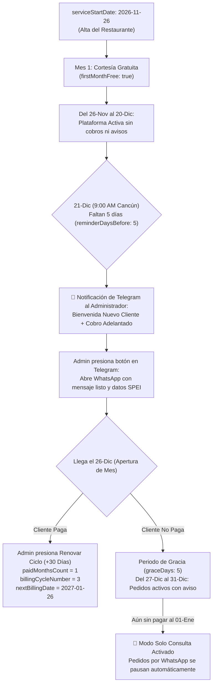

# ☕ Cafetería María Bonita — Menú Digital Interactivo (Next.js + Docker)

Una aplicación web moderna, accesible y modular desarrollada en **Next.js 14**, **React** y empaquetada con **Docker**, diseñada para **Cafetería María Bonita** (*"Sabor de hogar, aroma a recién molido"*).

---

## 🚀 Inicio Rápido

### Opción 1: Ejecutar con Docker (Recomendado)

Asegúrate de tener Docker instalado y ejecutándose:

```bash
# Construir e iniciar el contenedor en segundo plano
docker compose up -d --build

# Ver logs del contenedor
docker compose logs -f

# Detener el contenedor
docker compose down
```

La aplicación estará disponible inmediatamente en: **`http://localhost:3003`**

---

### Opción 2: Ejecutar en Desarrollo Local con Node.js

```bash
# 1. Instalar dependencias
npm install

# 2. Iniciar servidor de desarrollo
npm run dev

# 3. Compilar para producción localmente
npm run build
npm start
```

---

## 🏗️ Arquitectura Modular en Next.js

La aplicación está dividida en componentes limpios y reutilizables dentro de `src/`:

```
menus/
├── Dockerfile                   # Construcción multi-stage ligera en Node.js 20 Alpine
├── docker-compose.yml           # Orquestación lista para producción (Puerto 3000)
├── .dockerignore                # Archivos omitidos del build de Docker
├── next.config.js               # Standalone output optimizado para contenedores
├── package.json                 # Dependencias (Next.js 14, React 18)
├── public/                      # Archivos estáticos y branding
│   └── assets/
│       └── redaysoft-badge.png  # Badge de la empresa desarrolladora
└── src/
    ├── app/
    │   ├── layout.jsx           # Layout raíz con metadata, viewport y Google Fonts
    │   ├── page.jsx             # Vista principal que orquesta los componentes
    │   └── globals.css          # Sistema de diseño, animaciones y CSS responsivo
    ├── components/
    │   ├── Header.jsx           # Barra de aviso en vivo, logo, navegación y drawer móvil
    │   ├── Hero.jsx             # Portada editorial con escenario 3D flotante dinámico
    │   ├── Specials.jsx         # Especialidades destacadas del día
    │   ├── MenuCatalog.jsx      # Catálogo interactivo agrupado por subcategorías
    │   ├── DishCard.jsx         # Tarjeta de platillo gourmet con estilo editorial (4 columnas)
    │   ├── DishDetailModal.jsx  # Modal de personalización de ingredientes y notas
    │   ├── CartDrawer.jsx       # Drawer de comanda, propina y generador de pedido a WhatsApp
    │   ├── AboutSection.jsx     # Historia y métricas de la cafetería
    │   ├── LocationSection.jsx  # Ubicación, mapa Google y horario en vivo
    │   ├── Footer.jsx           # Pie de página y enlace a https://redaysoft.com
    │   └── Toast.jsx            # Notificaciones flotantes
├── data/                        # Configuración y datos desacoplados en archivos JSON
│   ├── brand.json               # Identidad de marca, logo, hero, títulos
│   ├── products.json            # Catálogo de platillos, precios, imágenes, opciones
│   ├── categories.json          # Categorías y filtros del menú
│   ├── billing.json             # Suscripción mensual, cuota, cortesía, pagos por adelantado
│   ├── location.json            # Horarios, estado abierto/cerrado, dirección, mapas
│   ├── contact.json             # WhatsApp, teléfonos, delivery y métodos de pago
│   └── about.json               # Historia, valores y estadísticas
└── src/
    ├── app/
    │   ├── layout.jsx           # Layout raíz con metadata, viewport y Google Fonts
    │   ├── page.jsx             # Vista principal que orquesta los componentes
    │   ├── admin/page.jsx       # Panel de control de facturación y comandas
    │   └── globals.css          # Sistema de diseño, animaciones y CSS responsivo
    ├── components/              # Componentes de UI (Header, Hero, Specials, etc.)
    ├── context/                 # Contextos de React (MenuDataContext, CartContext)
    └── utils/                   # Utilidades puras (formatUtils, scheduleUtils, orderStorage)
```

---

## 📦 Base de Datos y Configuración Modular (`/data/*.json`)

Todos los datos se administran de manera directa y desacoplada desde los archivos JSON en `/data`:
- **`data/brand.json`**: Nombre del negocio, logo, título, subtítulos y copy del banner principal.
- **`data/products.json`**: Catálogo completo de platillos, precios, imágenes y modificadores.
- **`data/categories.json`**: Categorías del menú y etiquetas.
- **`data/billing.json`**: Configuración de facturación (cuota mensual, primer mes gratis, ciclo de cobro por adelantado, cuenta SPEI).
- **`data/location.json`**: Horarios comerciales, modo manual/automático y ubicación.
- **`data/contact.json`**: Costo de envío a domicilio, número de WhatsApp para comandas y formas de pago.
- **`data/about.json`**: Métricas y datos de la empresa.

---

## 🔄 Proceso del Ciclo de Facturación, Cortesía y Notificaciones

El sistema opera bajo un modelo de **pago por adelantado para aperturar el mes de servicio**, con soporte para **primer mes de cortesía gratuito** y recordatorios automáticos hacia un **Bot de Telegram del administrador** y **WhatsApp del cliente**:



### 📅 Ejemplo Práctico: Alta 26-Noviembre y Cobro 26-Diciembre

Con la siguiente configuración en `data/billing.json`:
```json
{
  "serviceStartDate": "2026-11-26",
  "nextBillingDate": "2026-12-26",
  "firstMonthFree": true,
  "billingCycleNumber": 2,
  "paidMonthsCount": 0,
  "reminderDaysBefore": 5,
  "graceDays": 5,
  "monthlyFee": 300,
  "paymentTiming": "advance"
}
```

1. **Del 26 de Noviembre al 20 de Diciembre (Periodo de Cortesía):**
   - El cliente disfruta su mes gratis de prueba.
   - El cron diario (que corre a las 9:00 AM hora Cancún) evalúa que faltan más de 5 días. **No se envía ninguna notificación ni interrupción**.

2. **El 21 de Diciembre a las 9:00 AM (Faltan exactamente 5 días):**
   - El sistema detecta `diffDays === reminderDaysBefore (5 días)`.
   - **Llega la alerta a Telegram**: Como `paidMonthsCount === 0`, el bot envía la notificación con el título `🎉 NOTIFICACIÓN DE COBRO: 1ER MES (BIENVENIDA NUEVO CLIENTE)`.
   - Incluye el resumen del restaurante, monto por adelantado ($300.00 MXN) y un botón interactivo que abre directamente el chat de WhatsApp con el cliente con el texto de bienvenida oficial y datos SPEI (BBVA, CLABE, Beneficiario, Referencia).

3. **Del 22 al 26 de Diciembre (Ventana de Recordatorio Diario):**
   - Mientras no se registre el pago, el cron envía 1 recordatorio preventivo al día a las 9:00 AM indicando los días restantes (4 días, 3 días, 2 días, 1 día y el día del corte).

4. **El 26 de Diciembre (Día de Apertura del Mes):**
   - Es la fecha límite para dar inicio formal al mes con servicio activo.
   - Si se registra el pago y se renueva el ciclo en `/admin`:
     - `paidMonthsCount` sube a `1`.
     - `billingCycleNumber` sube a `3`.
     - `nextBillingDate` avanza al `2027-01-26`.
     - A partir del siguiente mes, las notificaciones serán el **recordatorio recurrente estándar** (sin bienvenida de cliente nuevo).

5. **Del 27 al 31 de Diciembre (Periodo de Gracia de 5 días):**
   - Si el cliente no ha pagado al 26 de Diciembre, la plataforma **no corta el servicio de golpe**: otorga 5 días de tolerancia donde las comandas por WhatsApp siguen funcionando.

6. **A partir del 1 de Enero de 2027 (Suspensión por Falta de Pago):**
   - Si expira el periodo de gracia sin pago, la plataforma cambia automáticamente a **Modo Solo Consulta**: el catálogo y precios siguen visibles, pero los pedidos a WhatsApp se bloquean hasta registrar el pago.

---

## 💻 Desarrollado por
Plataforma creada y diseñada por [RedaySoft.com](https://redaysoft.com).
